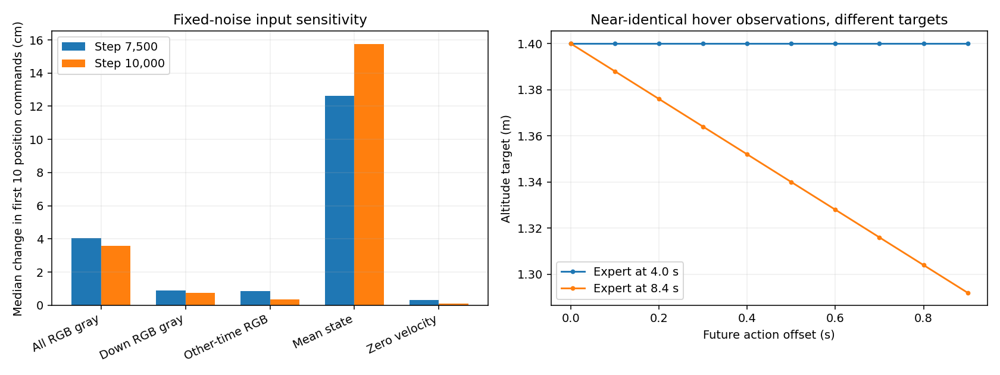

# M5 failure diagnosis

The recorded failures expose two priorities: demonstrations contain hidden timing requirements, and the policy closes the gripper without reliable alignment or recovery. Neither checkpoint completed a lift. The input tests show sensitivity to RGB and state, but do not establish correct visual grounding.

## Hidden timing in demonstrations

The expert requires at least eight seconds in `approach`, then another 0.5-second condition dwell before moving on. Its `lift` and `loaded_hold` stages also impose long measurement holds. The policy receives current RGB, eight state values and one fixed instruction; it receives neither elapsed time nor expert stage or observation history.

Across all 20 existing demonstrations, comparing 4.0 s with 8.4 s gives a median position difference of 1.14 mm (maximum 1.89 mm), while the next ten altitude targets differ by 6.41 cm RMS. Average pixel differences are 0.50% front, 0.61% down and 0.32% external on the [0,1] scale. These observations are close, not identical: velocity, pixels and small state changes can differ. Hidden timing is a supported ambiguity hypothesis, not a proof that it alone causes the failures.

## Input interventions

Selected requests nearest 0, 8, 15, 30, 40 and 60 seconds in each of the six recorded trials; duplicate requests were removed. Step 7,500 has 35 samples, step 10,000 has 36. Each intervention keeps the instruction, sampling noise and original action-decoding anchor fixed. Baseline predictions reproduced the saved outputs exactly, and repeated baseline predictions were identical for all 71 requests.

| Intervention | Step 7,500 median change | Step 10,000 median change |
|---|---:|---:|
| All RGB gray | 4.03 cm | 3.58 cm |
| Down RGB gray | 0.88 cm | 0.73 cm |
| Other-time RGB | 0.85 cm | 0.35 cm |
| Mean state | 12.64 cm | 15.74 cm |
| Zero velocity | 0.30 cm | 0.12 cm |

Change means RMS Euclidean displacement of the first ten position commands, then the median across requests. Gray RGB uses pixel value 128; other-time RGB comes from the opposite end of the same episode; mean state sets normalized state to zero; zero velocity removes only the three physical velocity values. Interventions can create out-of-distribution or inconsistent observations, and their magnitudes are not comparable measures of modality importance. These are sensitivity measurements, not new flight trials.



## Recorded approach and closure failures

| Step | Episode | First descent below 1.2 m | First closure horizontal offset from block | Closed two-finger contact duration |
|---|---:|---:|---:|---:|
| 7,500 | 0 | 21.58 s | 25.0 cm | 0.000 s |
| 7,500 | 4 | 18.00 s | 6.5 cm | 0.000 s |
| 7,500 | 16 | 28.20 s | No closure | 0.000 s |
| 7,500 | 17 | 60.86 s | 5.8 cm | 0.000 s |
| 7,500 | 18 | 35.45 s | 3.2 cm | 0.450 s |
| 7,500 | 19 | 39.55 s | 26.2 cm | 0.000 s |
| 10,000 | 0 | 35.97 s | 2.8 cm | 1.835 s |
| 10,000 | 4 | 9.76 s | 86.5 cm | 0.000 s |
| 10,000 | 16 | Never | No closure | 0.000 s |
| 10,000 | 17 | Never | No closure | 0.000 s |
| 10,000 | 18 | Never | No closure | 0.000 s |
| 10,000 | 19 | Never | No closure | 0.000 s |

Offsets use current drone and block centers at the first logged tick after the close command, not fingertip clearance. Step 10,000 episode 4 had already displaced the block, explaining its very large offset. Contact duration can include contact during a fall and does not establish stable grasp retention. The final checkpoint never descended below 1.2 m or closed its gripper in any validation trial.

## Next data revision

1. Create a separate demonstration protocol that removes the eight-second initial wait and measurement-only lift/loaded holds. Advance on achieved pose, low velocity and contact/retention conditions with a short settling dwell. Preserve the original expert and evaluation protocol for comparison.
2. Validate that expert physically before collecting at scale: aligned pickup, lateral misalignment, shifted block, failed closure, and lost-contact recovery. Use the current block pose for expert corrections; privileged object/contact state stays out of policy inputs.
3. Start corrective collection from training scenarios only (source episodes 0–15). Vary lateral approach offsets and descent starts; include reopening, realignment and retry trajectories. Episodes 16–19 remain validation and must not become corrective training examples.
4. Use a new dataset directory and training-only normalization. Inspect action-target consistency around transitions, then run a small learning/closed-loop pilot before another full server run. Keep batch 4 locally and the current controller unchanged.
5. Reserve fresh scenarios for a final untouched/OOD test. Only revisit observation history or progress conditioning if the revised state-driven demonstrations still show transition ambiguity; adding a timer solely to reproduce the old measurement waits is not the first fix.

This diagnosis adds no training, new demonstrations, environment packages or controller changes. RTC remains deferred. The proposed data revision still needs implementation and physical validation.

## Evidence and reproduction

[Raw diagnostic summary](diagnosis.json) includes sample IDs, interventions, per-request metrics, closure events and all 20 demonstration pairs. [Previous comparison and videos](baseline_comparison.md) contains the physical rollouts. The reusable diagnostic entry point is [m5_diagnose.py](../../scripts/m5_diagnose.py). Run from the repository root, using fresh output directories:

```bash
bash scripts/run_lerobot.sh scripts/m5_diagnose.py --step 007500 --output artifacts/M5/diagnosis_007500
bash scripts/run_lerobot.sh scripts/m5_diagnose.py --step 010000 --output artifacts/M5/diagnosis_010000
```
