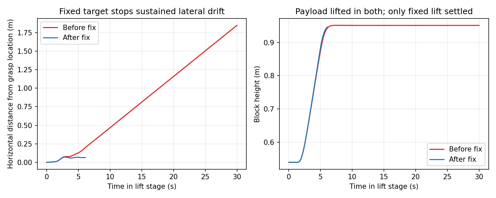
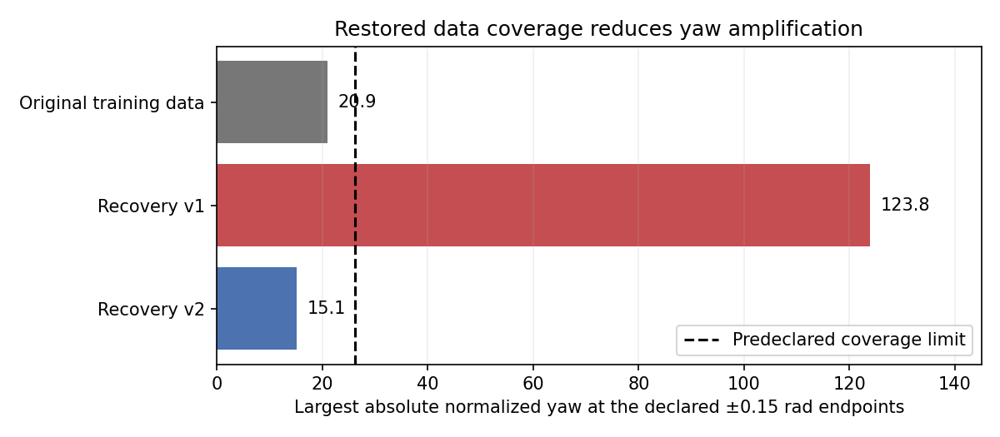

# Recovery v2: restore reset coverage and fix expert lift drift

Status on 2026-10-22: **expert and data fixes verified; learned policy remains unsuccessful (0/6).** The bounded 2,500-step training pilot, six fixed physical trials, execution audit and video checks are complete.

## Changes

- Retain all 16 original training reset configurations, including positions, yaw and seeds. Add eight lateral/near-grasp starts covering the existing declared yaw range of ±0.15 rad.
- Require settled heading before descent and closure. Keep the original simulator, low-level controller, fixed evaluation starts, safety limits and success criteria.
- Fix the expert's lift target: latch horizontal block position at a confirmed grasp instead of continually following the attached block. Refresh this target on every re-grasp.
- Add training-data coverage checks and a training guard that rejects failed, stale or mismatched coverage reports. Existing configurations without this optional guard retain their behavior.

The new near-grasp pilot exposed sustained lateral drift in the previous expert. With identical reset configurations and identical pre-lift states, fixing the lift target reduced maximum horizontal displacement from **1.85 m to 7.2 cm**. The old lift timed out after 30 seconds; the corrected lift settled in 6.2 seconds and the full placement succeeded. This is an expert-control fix, not a learned-policy result.

[Before video](recovery_v2_work/lift_before.mp4) · [After video](recovery_v2_work/lift_after.mp4)



## Physical and data checks

The corrected expert passed **10/10 pilot cases**: two original starts, two lateral starts, two near-grasp starts, and missed-closure/lost-contact injections on two training layouts. All four injected-fault cases recovered with one retry. Collection then passed **24/24 episodes**.

The separate dataset `datasets/airvla_m5_recovery_v2` contains:

| Split | Episodes | Rows |
|---|---:|---:|
| Training | 28 | 10,191 |
| Validation | 4 | 2,068 |

Training comprises 16 original-reset episodes, eight added approaches, and four successful post-fault recovery suffixes. Injected-fault prefixes are excluded. A recorded suffix requires full physical-state restoration for replay; it is not an independent reset configuration. The four original validation recordings are unchanged.

All **13 alignment checks** and **nine coverage checks** passed. The 16 recorded original initial states match M3 exactly. The new yaw standard deviation is 0.00995 rad, versus 0.00121 rad in recovery v1. The declared ±0.15 rad endpoints normalize to approximately ±15.1; the previous dataset produced a maximum absolute endpoint value of 123.8. The coverage limit was declared from the original training design/statistics before collection; no validation states were used to calculate it. Numeric normalization itself was not changed or clipped.



Checks included 12,259 raw chunks, 328 loader chunks and 186 exact image comparisons. The training guard binds the passed coverage report to the dataset identifier and normalization SHA256. Shared environments and source installations were preserved; no packages were installed.

Expert recovery videos: [missed closure](recovery_v2_pilot_fixed/previews/episode_006.mp4), [lost contact](recovery_v2_pilot_fixed/previews/episode_007.mp4), [second-layout lost contact](recovery_v2_pilot_fixed/previews/episode_009.mp4).

## Learning pilot and evaluation

The bounded pilot starts from `pi0_base`, using the new training-only statistics, batch 4, 2,500 steps, a frozen vision-language backbone, BF16 and gradient checkpointing. It uses 250 warmup steps and cosine decay from 5e-5 to 5e-6. This is a shorter learning pilot, not a matched 10,000-step comparison. See [configuration](../../configs/train_recovery_v2_pilot.yaml).

Training completed with exact checkpoint reload predictions. Optimizer time was 1,138 seconds (19.0 minutes), with 10.97 GiB peak allocated CUDA memory. Final training position-command RMSE was 5.99 cm; validation RMSE was 15.58 cm, with 98.63% gripper accuracy. These are offline action metrics, not physical task success.

The predeclared final pilot checkpoint scored **0/2 familiar and 0/4 validation successes**, with no closed-gripper grasp contacts or lifts. Four trials stopped before applying an unsafe height command; two timed out. Some single-finger contacts occurred, which do not satisfy the grasp metric. Original starts, inference seeds, action schedule, controller, safety limits and success criteria were unchanged.

Offline evaluation on the original M5 recordings uses the saved checkpoint statistics: familiar command RMSE is 17.00 cm and validation command RMSE is 17.07 cm. These old timed targets remain a qualified diagnostic, with different sampling from training-time validation. Repeated fixed trials are development evaluation, not an untouched or deliberate OOD test. No full 10,000-step run was launched.

## Physical outcomes and remaining problem

| Episode | Outcome | Duration | Video |
|---|---|---:|---|
| 0 | unsafe_command | 27.6 s | [Watch](recovery_v2_eval/closed_loop/trials/episode_000/rollout.mp4) |
| 4 | unsafe_command | 36.4 s | [Watch](recovery_v2_eval/closed_loop/trials/episode_004/rollout.mp4) |
| 16 | timeout | 80.0 s | [Watch](recovery_v2_eval/closed_loop/trials/episode_016/rollout.mp4) |
| 17 | unsafe_command | 46.3 s | [Watch](recovery_v2_eval/closed_loop/trials/episode_017/rollout.mp4) |
| 18 | unsafe_command | 40.8 s | [Watch](recovery_v2_eval/closed_loop/trials/episode_018/rollout.mp4) |
| 19 | timeout | 80.0 s | [Watch](recovery_v2_eval/closed_loop/trials/episode_019/rollout.mp4) |

[Trajectory plots](recovery_v2_eval/rollout_metrics.png).

The learned policy descends, but closes with inaccurate alignment. In episode 0, the first closure is 6.9 cm above the grasp height and 5.3 cm off horizontally. Episode 4 closes 14.9 cm off horizontally. All six trials reach an empty, fully closed gripper aperture of about **3 cm**; the training data contains only **8–14 cm**, with zero rows below 5 cm. The current `missed_closure` injection forces the gripper open, so its recovery examples do not demonstrate recovery from an actual closed-empty grasp.

This is an observed coverage gap, not proof that it alone causes failure. The policy also needs more precise approach/closure behavior; the training expert closes within 3.4 mm of the target height. The pilot processed approximately 10,000 sampled rows against 10,191 training rows and is shorter than the older runs, so training duration is another unresolved factor.

Next: physically validate closed-empty missed-grasp recovery on training scenarios, then collect alignment, reopen and retry demonstrations from those states. Check that the exported observations contain the failure states and corrective actions. Use a bounded pilot and the unchanged six-trial evaluation before committing to another full run. Do not add a privileged grasp override to policy evaluation. RTC and a fresh untouched/OOD suite remain later work.

## Verification

- 29 tests passed across expert/reset planning, coverage, training schedule/guard, adapter and rollout behavior.
- Fresh expert replay passed all 517 commands and 10,340 physics ticks, with maximum reconstruction error 5.96e-8.
- The execution audit passed all 12 checks; 2,824 applied learned commands matched decoded predictions exactly. Physics continued during inference and camera ages stayed within 0.1 s.
- All six learned rollout videos passed frame-count checks. Representative closure frames and the trajectory plots were inspected.
- Checkpoint file hashes and detailed evidence are in the JSON report. Shared source checkouts are clean; no environment packages were installed.

Detailed evidence: [recovery_v2_result.json](recovery_v2_result.json). Large datasets, model files, videos and logs remain Git-ignored.

## Commands

Run from the repository root, with fresh output directories if repeating:

```bash
bash scripts/run_isaac.sh scripts/m5_collect_recovery.py --protocol v2 --mode pilot \
  --enable_cameras --output artifacts/M5/recovery_v2_pilot_fixed
bash scripts/run_isaac.sh scripts/m5_collect_recovery.py --protocol v2 --mode collect \
  --pilot-result artifacts/M5/recovery_v2_pilot_fixed/result.json \
  --enable_cameras --output artifacts/M5/recovery_v2_collection
/home/user/miniconda3/envs/isaaclab/bin/python -B scripts/m5_prepare_recovery_export.py \
  --collection artifacts/M5/recovery_v2_collection --pilot artifacts/M5/recovery_v2_pilot_fixed \
  --output artifacts/M5/recovery_v2_export
bash scripts/run_lerobot.sh scripts/m5_check_recovery_coverage.py --raw artifacts/M5/recovery_v2_export
bash scripts/run_lerobot.sh -m airvla_isaac.data.convert_to_lerobot \
  --raw artifacts/M5/recovery_v2_export --destination datasets/airvla_m5_recovery_v2
bash scripts/run_lerobot.sh -m airvla_isaac.data.validate_dataset \
  --raw artifacts/M5/recovery_v2_export --dataset datasets/airvla_m5_recovery_v2
bash scripts/run_lerobot.sh scripts/m5_check_recovery_coverage.py \
  --raw artifacts/M5/recovery_v2_export --dataset datasets/airvla_m5_recovery_v2
bash scripts/run_lerobot.sh scripts/m4_train.py --config configs/train_recovery_v2_pilot.yaml
```

The evaluated settings are saved in [configs/eval_recovery_v2_pilot.yaml](../../configs/eval_recovery_v2_pilot.yaml). To repeat evaluation with a fresh output directory:

```bash
out=artifacts/M5/recovery_v2_recheck
cfg=configs/eval_recovery_v2_pilot.yaml
bash scripts/run_lerobot.sh scripts/m5_offline.py --config "$cfg" --output "$out/offline"
bash scripts/run_isaac.sh scripts/m5_sim.py --mode replay --enable_cameras \
  --config "$cfg" --output "$out/replay"
/home/user/miniconda3/envs/isaaclab/bin/python -B scripts/m5_run.py \
  --config "$cfg" --replay-root "$out/replay" --output "$out/closed_loop"
bash scripts/run_lerobot.sh scripts/m5_verify.py \
  --config "$cfg" --replay-root "$out/replay" --root "$out"
MPLCONFIGDIR="$PWD/artifacts/M5/plot_cache" /home/user/miniconda3/envs/isaaclab/bin/python -B \
  scripts/m5_summarize.py --root "$out" --policy-only
```
