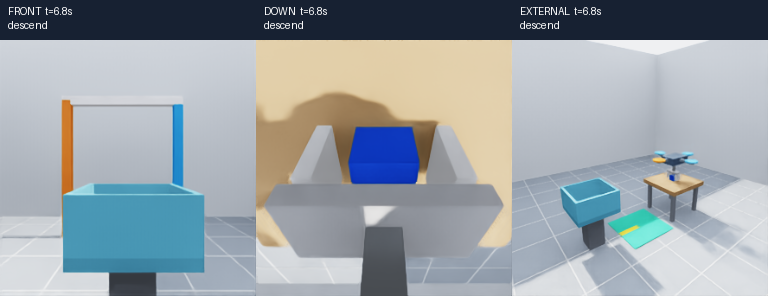
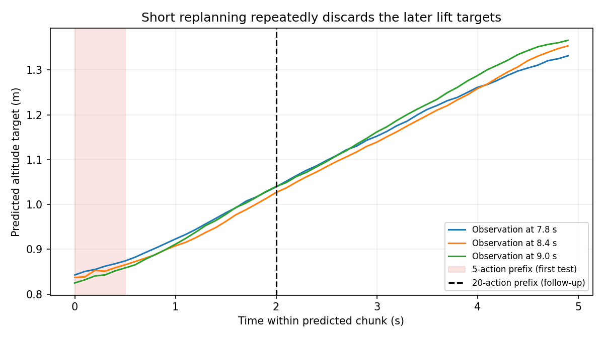

# Single-scene first-attempt pilot

Status on 2026-10-22: **one complete learned pick-and-place achieved** in the fixed blue-block scene. The first five-action-prefix trial failed; the same trained checkpoint succeeded when executing 20 actions per chunk. This is a demonstration result, not a reliability or generalization estimate.

[Watch the successful policy video](single_scene_execute20_eval/closed_loop/trials/episode_000/rollout.mp4) · [Trajectory and contact plots](single_scene_execute20_eval/rollout_metrics.png)

This experiment follows the request to pursue one successful learned pick-and-place before further recovery work. It uses one fixed layout and a clearly contrasting blue block. The existing M5 benchmark, original colors, physics and shared environments are preserved.



## Setup

- Fix block/bin layout, initial yaw at zero and reset jitter at zero. Six training starts include the exact aligned start, four small horizontal offsets and one lower approach. Two monitoring starts differ only by small initial-position offsets; they are not unseen scenes.
- Collect complete successful placements with the corrected state-driven expert. Require zero retries and no injected faults.
- Sample descent, grasp and lift rows at three times the weight of other stages. Preserve target actions, normalization and unweighted monitoring.
- Train the π0 action expert from the base checkpoint for a bounded 2,000 steps, batch 4, BF16, frozen vision-language backbone. See [training config](../../configs/train_single_scene.yaml).
- Evaluate the predeclared final checkpoint at the exact familiar start. The initial test executed five 10 Hz actions per response and failed; the successful follow-up executed 20. Both use only learned actions, with physics continuing during inference and no privileged grasp assistance. Preserve the [initial settings](../../configs/eval_single_scene.yaml); use the [successful settings](../../configs/eval_single_scene_execute20.yaml) for this demonstration.

This changes several factors together to pursue a working demonstration. It is not an isolated test of block color or a comparison against the unchanged six-trial M5 benchmark.

## Results

All eight expert demonstrations completed grasp, lift, transport and placement with zero retries. The dataset contains 2,137 training rows and 694 reset-only monitoring rows. All 13 alignment checks passed, including 2,831 raw chunks, 80 loader chunks and 90 exact image comparisons. Fourteen regression tests passed. Training completed in 913.6 optimizer seconds (15.2 minutes), with 10.97 GiB peak allocation and exact reload predictions. Final training/monitoring position-command RMSE was 3.94/3.96 cm; monitoring gripper accuracy was 99.13%. On five sampled near-grasp states, the first predicted action had 8.2 mm mean position error but only 3/5 open/close labels agreed at the transition. These are offline metrics; the physical results below decide task success. Evidence is recorded in [single_scene_result.json](single_scene_result.json).

| Same 2,000-step checkpoint | Grasp | Lift | Placement | Simulated duration |
|---|---|---|---|---:|
| Execute 5 actions per chunk | Yes | No | No — unsafe state | 14.3 s |
| Execute 20 actions per chunk | Yes | Yes | **Success** | 29.005 s |

The successful run closed at 6.7 s, only 7.1 mm above the intended grasp height and 2.1 mm off horizontally. It made both contacts at 6.72 s and crossed the lift threshold at 11.64 s. The block rose from 0.54 m to a maximum height of 0.949 m, was carried to the bin, and settled after release for 2.005 s. There was **one grasp closure before lift**, with no grasp retry. Two brief extra close pulses occurred during release after 26.4 s; the placement still passed. This release chatter remains a limitation.

## What changed between the failed and successful trials

The five-action trial grasped, but stayed near 0.82 m altitude with the block still supported by the table. Its saved predictions contained a rising lift trajectory, yet repeatedly executing only the first 0.5 s discarded the later, higher targets. For example, the prediction at 7.8 s reached approximately 0.87 m within its first five actions and 1.03 m by its twentieth action.



Executing a constant 20-action prefix allowed more of the policy's lift sequence to run before replanning. The model weights, preprocessing, physics, scene, initial state, nominal inference seed and success criteria were unchanged. No corrective training or scripted action override was added. The changed request schedule also changes subsequent observations and noise-to-time alignment, so this is evidence consistent with the prefix diagnosis rather than a complete causal ablation.

The [failed video](single_scene_eval/closed_loop/trials/episode_000/rollout.mp4) is preserved alongside the success. Offline scores were reused for the follow-up because the checkpoint, dataset and offline inference settings were identical. Expert replay was also reused; it reproduces the same absolute recorded commands.

## Verification

- All eight expert demonstrations passed without retries; 13 dataset checks and 14 regression tests passed.
- Checkpoint reload predictions matched exactly. File hashes are stored in the result JSON.
- Expert replay passed 342 commands and 6,840 physics ticks, with maximum reconstruction error 5.96e-8.
- Both policy execution audits passed. The successful run audited all 277 applied learned commands with zero decoding discrepancy, 5,801 physics ticks, 14 inference responses and maximum camera age 0.1 s.
- The expert replay and both policy videos passed frame-count checks. Successful lift/placement frames and trajectory plots were inspected.
- Shared source checkouts remained clean; no environment packages were installed. Recovery-data work remains deferred at the user's request.


## Reproduction

Run from the repository root. Existing output directories are protected; use fresh paths when repeating.

```bash
/home/user/miniconda3/envs/isaaclab/bin/python -B scripts/m5_prepare_single_scene.py
bash scripts/run_isaac.sh scripts/m5_collect_single_scene.py --enable_cameras \
  --plan artifacts/M5/single_scene_work/plan.json --output artifacts/M5/single_scene_collection
bash scripts/run_lerobot.sh -m airvla_isaac.data.convert_to_lerobot \
  --raw artifacts/M5/single_scene_collection --destination datasets/airvla_single_scene_v1
bash scripts/run_lerobot.sh -m airvla_isaac.data.validate_dataset \
  --raw artifacts/M5/single_scene_collection --dataset datasets/airvla_single_scene_v1
python scripts/m5_single_scene_weights.py \
  --raw artifacts/M5/single_scene_collection --dataset datasets/airvla_single_scene_v1
bash scripts/run_lerobot.sh scripts/m4_train.py --config configs/train_single_scene.yaml
```

Raw recordings, dataset images, checkpoints and videos remain local and Git-ignored. No packages are installed by this workflow.

To reproduce the successful learned demonstration with the saved checkpoint and fresh output paths:

```bash
out=artifacts/M5/single_scene_recheck
cfg=configs/eval_single_scene_execute20.yaml
bash scripts/run_lerobot.sh scripts/m5_offline.py --config "$cfg" --output "$out/offline"
bash scripts/run_isaac.sh scripts/m5_sim.py --mode replay --enable_cameras \
  --config "$cfg" --output "$out/replay"
/home/user/miniconda3/envs/isaaclab/bin/python -B scripts/m5_run.py \
  --config "$cfg" --replay-root "$out/replay" --output "$out/closed_loop"
bash scripts/run_lerobot.sh scripts/m5_verify.py \
  --config "$cfg" --replay-root "$out/replay" --root "$out"
MPLCONFIGDIR="$PWD/artifacts/M5/plot_cache" /home/user/miniconda3/envs/isaaclab/bin/python -B \
  scripts/m5_summarize.py --root "$out"
```

Saved-video playback does not run Isaac Sim. The checkpoint is local at `artifacts/M5/single_scene_train/checkpoint/`; source checkout alone does not include the ignored model or dataset.
